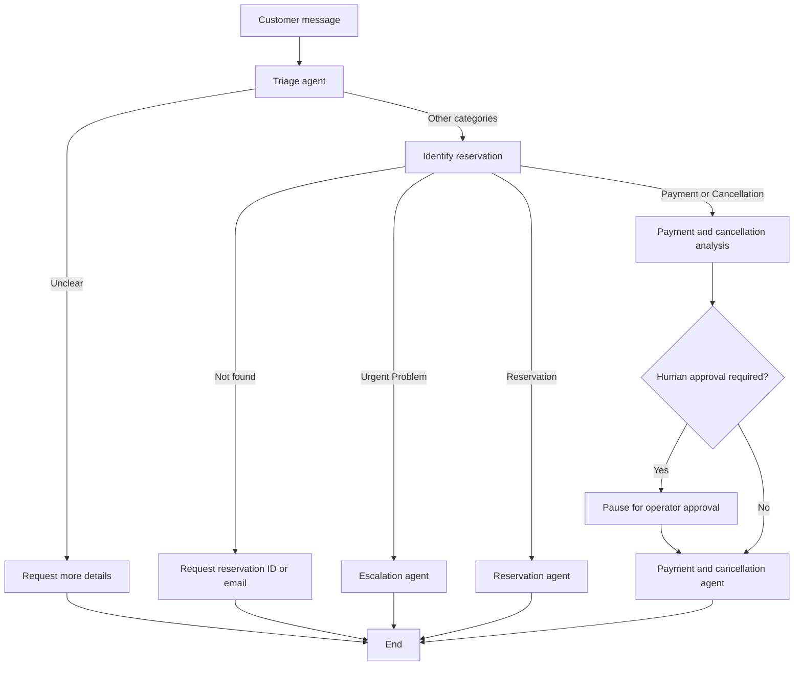

# StayWise — Multi-Agent Customer Support System

A Python-based customer support prototype for **StayWise**, a fictional short-term rental platform. The project uses **LangGraph** to coordinate specialized LLM-powered agents for reservation inquiries, payments, cancellations, and urgent issues. It also compares LLM-based ticket classification against classical machine learning approaches.

> **Academic prototype:** StayWise uses synthetic reservation and invoice data. Refund decisions and escalation tickets are simulated; the project does not process real payments or connect to a production booking platform.

## Features

- **Ticket triage:** classifies incoming messages into `Reservation`, `Payment`, `Cancellation`, `Urgent Problem`, or `Unclear`.
- **Reservation identification:** looks up bookings using a reservation ID or the email address supplied in the message.
- **Specialized responses:** routes booking questions to a reservation agent and payment/cancellation questions to a dedicated agent.
- **Policy-based decisions:** checks reservation and invoice records and applies cancellation/refund logic through Python tools.
- **Human-in-the-loop approval:** pauses the LangGraph workflow when a refund requires review; an operator can approve or reject it before the customer-facing response is generated.
- **Escalation:** creates a simulated support ticket for urgent problems.
- **Execution tracing:** displays the sequence of workflow decisions in the terminal.
- **ML comparison:** evaluates TF-IDF + Logistic Regression and TF-IDF + Multinomial Naive Bayes, including hyperparameter-tuned variants.

## Architecture

The application is a command-line interface built around a stateful LangGraph workflow:



The **Triage Agent** extracts the category, urgency, reservation identifier, and a short summary. The **Reservation Agent** answers booking-related questions. The **Payment & Cancellation Agent** produces responses based on invoice data and the results of deterministic analysis tools. The **Escalation Agent** handles urgent cases by creating a support ticket. The graph also includes dedicated paths for unclear requests and missing reservations.

LangGraph maintains workflow state and uses an in-memory checkpointer to resume interrupted executions. The command-line application assigns a unique thread ID to each request.

## Tech Stack

- **Python** — application logic and data processing
- **LangGraph** — agent orchestration, conditional routing, state management, and interrupts
- **Groq API** — LLM inference; the default configured model is `llama-3.3-70b-versatile`
- **scikit-learn** — TF-IDF, classical classifiers, GridSearchCV, and evaluation metrics
- **pandas** — CSV-based data and evaluation results
- **joblib** — serialized ML pipelines

The LLM integration uses a provider abstraction (`llm/base.py`, `llm/factory.py`). **Groq is the currently implemented provider**; other providers would require an additional implementation.

## Project Structure

```text
customer-support-multi-agent/
├── agents/                  # Triage and specialized support agents
├── data/                    # Synthetic reservations, invoices, and historical tickets
├── evaluation/
│   ├── evaluate_agents.py   # Multi-agent evaluation script
│   ├── test_cases.csv       # Shared evaluation cases
│   └── results/             # Saved agent evaluation
├── llm/                     # LLM provider interface, factory, and Groq adapter
├── ml/
│   ├── experiments/         # Archived first dataset experiment (V1)
│   ├── models/              # Trained V2 ML pipelines
│   ├── results/             # Per-model reports, predictions, and plots
│   ├── compare_models.py
│   ├── train_logistic_regression.py
│   ├── train_logistic_regression_optimized.py
│   ├── train_naive_bayes.py
│   └── train_naive_bayes_optimized.py
├── policies/                # Cancellation and payment policy text
├── prompts/                 # Agent and synthetic-data-generation prompts
├── tools/                   # Reservation, invoice, refund, payment, and ticket tools
├── workflow/
│   ├── graph.py             # LangGraph nodes, edges, and routing
│   └── state.py             # Shared support state
├── main.py                  # Interactive CLI entry point
├── requirements.txt
└── README.md
```

## Getting Started

### 1. Clone the repository

```bash
git clone https://github.com/sircatina/staywise-multi-agent-customer-support.git
cd staywise-multi-agent-customer-support
```

### 2. Create and activate a virtual environment

On Windows (PowerShell):

```powershell
python -m venv .venv
.\.venv\Scripts\Activate.ps1
```

On macOS or Linux:

```bash
python3 -m venv .venv
source .venv/bin/activate
```

### 3. Install dependencies

```bash
python -m pip install -r requirements.txt
```

### 4. Configure the LLM

Create a `.env` file in the project root:

```dotenv
GROQ_API_KEY=your_groq_api_key_here
LLM_PROVIDER=groq
LLM_MODEL=llama-3.3-70b-versatile
```

Obtain an API key from [Groq Console](https://console.groq.com/). The provider and model variables are optional because the code supplies the values shown above as defaults. **Never commit a real API key.** Model availability and API usage limits depend on your Groq account.

### 5. Run the application

From the project root:

```bash
python main.py
```

Enter a customer message when prompted. For example:

```text
Customer message: I have a question about reservation RZ-1001.
```

The program processes one message, prints the final customer response, and shows the execution trace. If the workflow requests refund approval, it pauses and prompts the operator:

```text
HUMAN APPROVAL REQUIRED
Approve refund? (yes/no):
```

The workflow then resumes with the operator's decision. This is an **interactive terminal demonstration**, not a deployed web service.

## Data and Ticket Categories

The project uses synthetic CSV datasets:

| File | Purpose |
| --- | --- |
| `data/reservations.csv` | Reservation records used for booking lookup |
| `data/invoices.csv` | Invoice and payment information associated with reservations |
| `data/historical_tickets.csv` | Labeled customer messages for classical ML training |
| `evaluation/test_cases.csv` | Shared test cases for evaluating the multi-agent system and ML models |

The classification task uses five categories: **Reservation**, **Payment**, **Cancellation**, **Urgent Problem**, and **Unclear**. The historical ticket dataset (V2) contains **100 synthetic messages**, with **20 messages per class**. It is distinct from the **20 shared evaluation cases** used in the agent-versus-ML comparison.

## Classical Machine Learning Experiments

Two text classification algorithms were tested:

1. **Logistic Regression** with TF-IDF features.
2. **Multinomial Naive Bayes** with TF-IDF features.

Each algorithm has a baseline and a tuned version. Hyperparameter optimization uses **GridSearchCV with five-fold stratified cross-validation**, scored using macro F1. The search explores word-level and character-level TF-IDF representations, along with model-specific parameters.

An earlier **V1 experiment** used more repetitive, structured messages. Its very high holdout score was not treated as evidence of strong generalization because the dataset contained similar message templates. The more diverse **V2 dataset** was used for the subsequent comparison.

### Train the models

Run these commands from the project root:

```bash
python ml/train_logistic_regression.py
python ml/train_logistic_regression_optimized.py
python ml/train_naive_bayes.py
python ml/train_naive_bayes_optimized.py
```

Each training script saves a serialized model under `ml/models/` and evaluation artifacts under its corresponding directory in `ml/results/`. These include classification reports, confusion matrices, metrics, and predictions. Tuned experiments also save the selected hyperparameters and grid-search results.

### Evaluation results

| Approach | V2 holdout accuracy (20 samples) | Shared test accuracy (20 cases) |
| --- | ---: | ---: |
| Logistic Regression — baseline | 55% | 60% |
| Logistic Regression — optimized | 55% | **75%** |
| Multinomial Naive Bayes — baseline | 45% | 60% |
| Multinomial Naive Bayes — optimized | **60%** | 70% |
| Multi-agent triage | Not evaluated on this ML holdout split | **100%** |

The **optimized Naive Bayes** model achieved the highest accuracy on the V2 holdout split, while **optimized Logistic Regression** performed best among the classical models on the shared 20-case test set. The multi-agent triage correctly classified all 20 shared cases.

These results are **small-sample experimental findings**, not a claim of production-level accuracy. The holdout and shared test sets measure performance on different examples and should not be treated as interchangeable. LLM-based classification also depends on the configured provider and model.

### Evaluate the multi-agent workflow

```bash
python evaluation/evaluate_agents.py
```

This script checks **both classification correctness and expected workflow action** for each case and writes detailed results to:

```text
evaluation/results/agent_evaluation.csv
```

The classification comparison in the table above is specifically about the **triage category**, not the correctness of every subsequent support action.

### Compare a classical model with the agent

```bash
python ml/compare_models.py
```

**Important:** `ml/compare_models.py` currently selects the model and output folder using the `MODEL_PATH` and `RESULTS_DIR` constants in the script. To compare another trained model, update both paths before running it. The script is not currently a command-line model selector.

The comparison produces `comparison_predictions.csv` and `model_comparison.json`, including predicted categories, confidence scores, and accuracy measurements. The saved agent results are matched by test-case ID.

## Design Considerations and Limitations

- **Synthetic data:** reservation, invoice, and training records do not represent a real booking platform.
- **Limited evaluation size:** both the ML holdout and shared comparison contain only 20 examples each.
- **LLM dependency:** multi-agent execution requires a configured Groq API key and network access; latency, costs, and model behavior can vary.
- **In-memory workflow state:** the LangGraph checkpointer is not configured for durable production storage.
- **Simulated operations:** approval and escalation demonstrate workflow logic; they do not execute real bank refunds or create tickets in an external help-desk platform.
- **CLI-only interface:** the application currently processes customer requests through the terminal.

## Potential Improvements

- Expand and independently validate the dataset with more varied, challenging, and ambiguous requests.
- Evaluate classification and downstream actions separately on larger test sets.
- Add persistent workflow storage and a user-facing interface.
- Add a configurable model selector to the ML comparison script.
- Integrate authenticated booking, payment, and support-ticket APIs for a production-oriented version.
- Add automated regression tests and more robust monitoring of LLM responses.

## Repository

Developed as an academic exploration of **agentic AI, customer support automation, and classical ML benchmarking**.

GitHub: [sircatina/staywise-multi-agent-customer-support](https://github.com/sircatina/staywise-multi-agent-customer-support)
